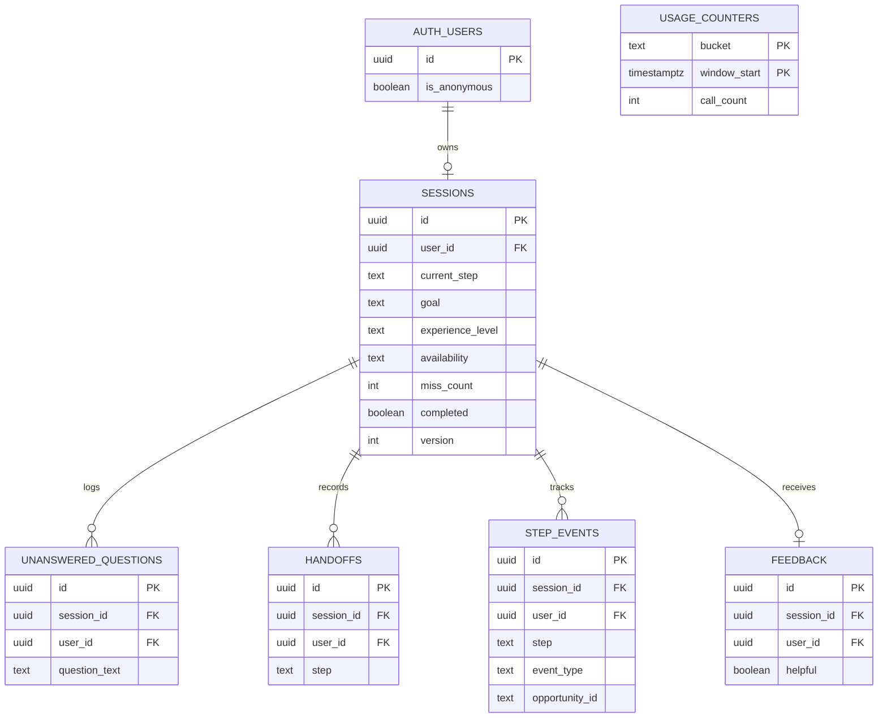

# FirstStep Database Design

Follows the class Database Design Template. The diagram is also saved on its own in [database-diagram.md](database-diagram.md). The tables are created by the migrations in `supabase/migrations`, which are the source of truth if this page and the database ever disagree.

**Notion copy:** [Database Design](https://app.notion.com/p/40f360ed631c81e589a6f0604e97a9ae) (first drafted November 5, 2026; this file updated November 10, 2026 to match both migrations).

**Lesson:** A table is one kind of thing. A row is one example of it. A key links rows together. Row Level Security (RLS) is the rule the database itself enforces about who can see each row, even if the app code has a bug.

## What does the app need to save?

- FirstStep saves each member's current step and answers, so they can continue later.
- FirstStep saves questions it could not answer, so coordinators can improve content.
- FirstStep saves each "Talk to a person" click, so the team can see where people need help.
- FirstStep saves progress events, so the team can see where people drop off.
- FirstStep saves "Was this helpful?" answers, to measure value.
- FirstStep counts Claude calls, so one person cannot run up the bill.

## Tables

### sessions

**What it stores:** one member's progress. Each person has one session, enforced by a unique `user_id`.

| Column name | Type of data | Required? | What it means |
|---|---|---|---|
| id | uuid | Yes | Unique code for the row |
| user_id | uuid | Yes | The person who owns this row, including guests |
| current_step | text | Yes | goal, experience, availability, results, no_match, or feedback |
| goal | text | No | One of the four allowed goals |
| experience_level | text | No | One of the three allowed levels |
| availability | text | No | One of the allowed hour ranges |
| miss_count | number | Yes | Misunderstood messages in a row, starting at 0 |
| completed | true or false | Yes | Whether they reached results |
| version | number | Yes | Goes up with each save, to catch two tabs editing at once |
| created_at, updated_at | date | Yes | When it started and last changed |

**Who can see it?** Only the owner.
**Who can add, change, or delete it?** The owner can add and change it. Rows are removed when the account is deleted.

### unanswered_questions

**What it stores:** questions FirstStep could not answer. A database trigger (`redact_contact_details`) removes emails and phone numbers before the row is saved.

| Column name | Type of data | Required? | What it means |
|---|---|---|---|
| id | uuid | Yes | Unique code |
| session_id | uuid | Yes | Which session it came from |
| user_id | uuid | Yes | The owner, used by access rules |
| question_text | text | Yes | The question, 1 to 500 characters |
| created_at | date | Yes | When it was asked. Deleted after 30 days. |

**Who can see it?** The owner, plus the coordinator through the Supabase dashboard.
**Who can add, change, or delete it?** The owner can add. Nobody can change it through the app.

### handoffs

**What it stores:** each "Talk to a person" click.

| Column name | Type of data | Required? | What it means |
|---|---|---|---|
| id | uuid | Yes | Unique code |
| session_id | uuid | Yes | Which session |
| user_id | uuid | Yes | The owner |
| step | text | Yes | Which step they were on |
| created_at | date | Yes | When it happened |

**Who can see it?** Only the owner through the app, and the team through the dashboard.
**Who can add, change, or delete it?** The owner can add. Nobody can change it through the app.

### step_events

**What it stores:** progress events for measuring completion, drop-off and recommendation clicks.

| Column name | Type of data | Required? | What it means |
|---|---|---|---|
| id | uuid | Yes | Unique code |
| session_id | uuid | Yes | Which session |
| user_id | uuid | Yes | The owner |
| step | text | Yes | Which step |
| event_type | text | Yes | started, answered, edited, completed, or recommendation_clicked |
| opportunity_id | text | No | Which opportunity was clicked, for the clicks KPI |
| created_at | date | Yes | When it happened |

**Who can see it?** Only the owner through the app, and the team through the dashboard.
**Who can add, change, or delete it?** The owner can add. Nobody can change it through the app.

### feedback

**What it stores:** one "Was this helpful?" answer per session.

| Column name | Type of data | Required? | What it means |
|---|---|---|---|
| id | uuid | Yes | Unique code |
| session_id | uuid | Yes | Which session, unique so each session rates once |
| user_id | uuid | Yes | The owner |
| helpful | true or false | Yes | Their answer |
| created_at | date | Yes | When it happened |

**Who can see it?** Only the owner through the app, and the team through the dashboard.
**Who can add, change, or delete it?** The owner can add. Nobody can change it through the app.

### usage_counters

**What it stores:** how many Claude calls a person, or the whole app, made in an hour or a day.

| Column name | Type of data | Required? | What it means |
|---|---|---|---|
| bucket | text | Yes | A person's ID, or `global` |
| window_start | date | Yes | Start of the hour or day |
| call_count | number | Yes | Calls so far |

**Who can see it?** Nobody through the app.
**Who can add, change, or delete it?** Only the `consume_chat_quota()` database function. RLS is on with no policies, so everything else is denied. This is the one table without a `user_id`, because it also holds the whole-app total.

## How the tables connect

- One person has one session. Each session belongs to one person.
- One session can have many unanswered questions, handoffs and step events. Each belongs to one session.
- One session can have one feedback answer.
- `usage_counters` stands alone on purpose. It counts calls and does not belong to a session.

## Database diagram



In words: Supabase's accounts table connects to one session, and the session connects to the four log tables. `usage_counters` connects to nothing.

## Access rules (Row Level Security)

The full rules are in `supabase/migrations/20261105120000_create_firststep_tables.sql`. This is the idea on one table:

```sql
alter table public.sessions enable row level security;

create policy "Owners can read their session"
  on public.sessions for select
  to authenticated
  using ((select auth.uid()) = user_id);
```

Read it as: "A signed-in person can read a row only if the row's owner is them." Guests count as signed in, because Supabase gives them a real user ID.

**A common surprise:** access rules hide rows without showing an error. If the app shows nothing and no error, check the rules first.

- [x] RLS is turned on for every table (6 of 6).
- [x] Each table has a rule that lets people see only their own rows (`usage_counters` has no rules, so nobody can read it).
- [ ] I tested this with two accounts. **Partly done:** `npm run isolation-test` passes 26 of 26 with two guest accounts, on a local copy and on the live site. The check with two signed-in Google accounts is still Preeti's to do (T-07).

## Database functions and scheduled jobs

These do the few privileged jobs, so the app never needs the Supabase secret key.

| Name | Job | Safety rule | Migration |
|---|---|---|---|
| `consume_chat_quota()` | Counts Claude calls and says whether a person is under their limits | Takes the person from `auth.uid()`, never from the browser | November 5 |
| `delete_my_account()` | Lets a member delete their own account, and their rows with it | Only ever deletes `auth.uid()`, the person calling it | November 9 |
| `redact_contact_details()` trigger | Removes emails and phone numbers from logged questions | Runs inside the database on every new row | November 9 |
| `cleanup_old_data()`, daily by `pg_cron` | Deletes logged questions older than 30 days, guest accounts with no saved answer in 30 days, and usage counts older than 2 days | Runs inside the database, on a schedule | November 9 |

Each function runs with raised permissions, so it sets a fixed `search_path` and was reviewed with extra care. The foreign keys use `on delete cascade`, so removing an account removes that person's rows.

## Migration files

| File | What it does |
|---|---|
| `20261105120000_create_firststep_tables.sql` | Creates the six tables, their access rules and `consume_chat_quota()` |
| `20261109120000_add_account_deletion_and_cleanup.sql` | Adds account deletion, contact-detail removal and the daily cleanup |

- [x] Every change to the database is saved as a SQL migration file in the repository.
- [x] Each migration file's name says what it does.
- [x] A migration that already ran is never edited. Changes go in a new migration.
