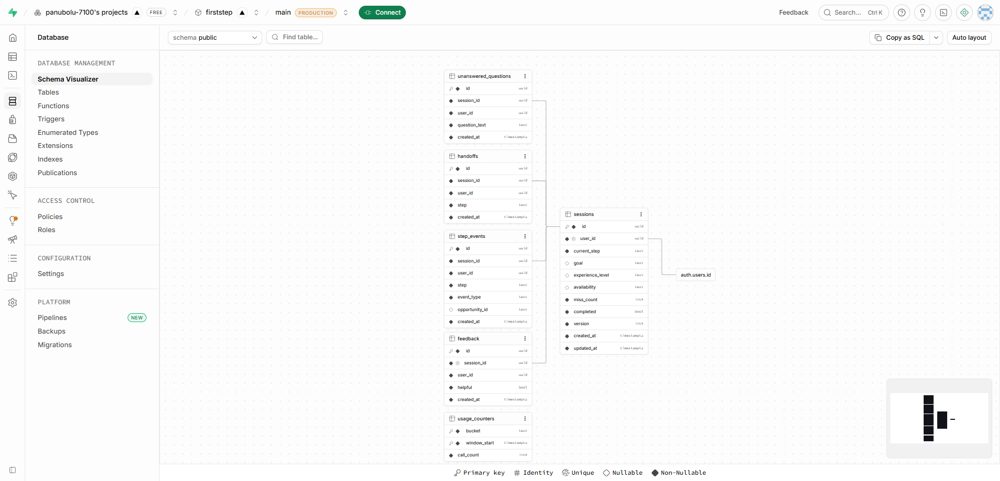

# FirstStep Database Diagram

From the Supabase Schema Visualizer, November 5, 2026.

## How the tables connect

- `sessions` belongs to one person in Supabase's `auth.users` table. Each person has one session.
- `unanswered_questions`, `handoffs` and `step_events` can each have many rows for one session.
- `feedback` has at most one row for each session.
- `usage_counters` stands alone. It counts Claude calls and does not belong to a session.
