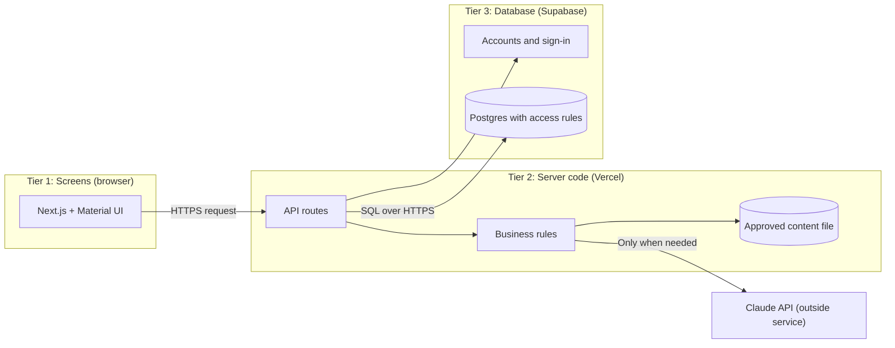
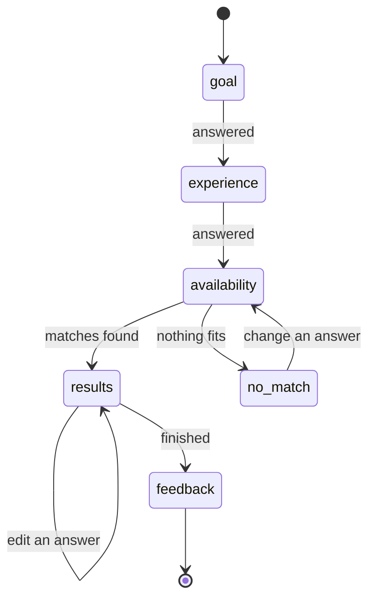
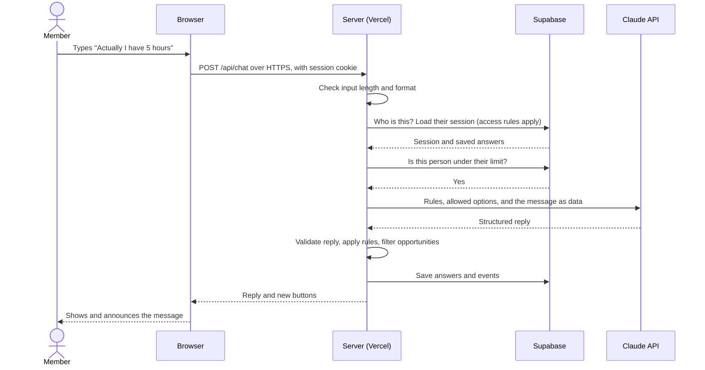
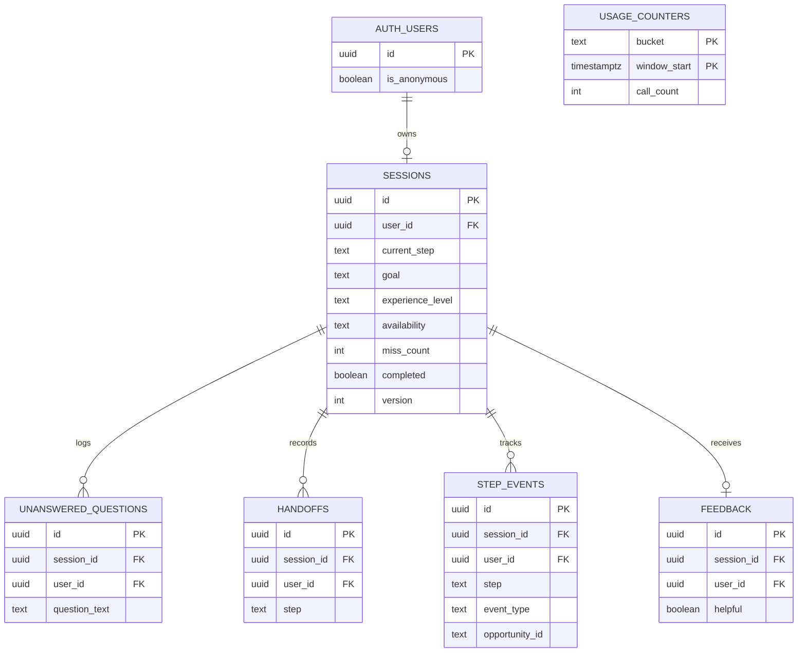

# FirstStep Technical Architecture

**Owner:** Preeti Anubolu, Premium Residency (Advanced homework track)
**Status:** Draft for your review
**Date:** November 4, 2026
**Product:** FirstStep, a conversational guide that helps new Tech Fleet members find a confident first step, using only approved content, with a real person one click away.

**Notion copy:** [Week 4 FirstStep Technical Architecture](https://app.notion.com/p/40f360ed631c81ba9de5cafbf7a8f070)

This is the blueprint to approve before anyone writes code. It covers Step 5 of your Build and Launch Checklist (architect the app), drafts Step 6 (ADRs) and drafts Step 7 (database design).

It follows the 9-step Language of Change process from the Week 4 lecture. Each step opens with a short lesson, then applies it to FirstStep.

---

## Start Here

### What is technical architecture?

Technical architecture is the plan for how an app is built: the parts, how they connect, and why each big choice was made. The lecture calls the architect the head chef. The head chef does not cook every dish. The head chef decides how the kitchen runs, then tastes every plate.

In this class, you and Claude share the architect hat, and Claude wears the developer hat. **Claude gives you facts and options. You make the choices.**

### The one idea to remember

> Architecture is the decisions that are hard to change later. Spend your care there, and make everything else easy to change.

### Five decisions that need you

Everything below works as a recommendation, but these are yours to approve. Open decisions are marked **Proposed** in the ADR list.

| # | Decision | My recommendation | Why it needs you |
|---|---|---|---|
| 1 | How people sign in (ADR-0010) | **Decided November 4, 2026:** start as a guest, then optionally sign in with Google to keep progress | Still check with your teacher that optional sign-in meets the homework. |
| 2 | Which Claude model (ADR-0011) | Decide after measuring both. The design starts on Opus 5.5 at low effort. | Opus 5.5 costs about 40 times as much as Haiku 5.5 per token. |
| 3 | Build the browse view now? (ADR-0013) | **Decided November 5, 2026:** yes, a simple version | It is a "Could" in your spec, but two "Must" requirements depend on it. |
| 4 | Where the code goes (ADR-0004) | **Decided November 4, 2026:** a new, dedicated repository, with the app in the `Week 3 Coding Challenge` folder | The homework says not to make a new repo, while the lecture says to. Tell your teacher, because the homework is about your submission. |
| 5 | Data region (ADR-0009) | **Decided November 5, 2026:** US East for both Vercel and Supabase | I assumed most members are in the Americas. A Supabase region is hard to change later. |

### Questions for your teacher

1. **Does optional sign-in meet "People can sign up and log in"?** FirstStep starts as a guest and offers Google sign-in. If sign-in must be required, drop the guest step. Most of the design still holds.
2. **Is a new repository okay?** The homework names one repository, the lecture says to create a new one, and the named repository does not exist on your GitHub account.
3. **Does "Every feature saves its information to Supabase" cover the browse view?** Browse reads the approved content file, not the database, by design (ADR-0012 and ADR-0013). If your teacher reads this strictly, a new migration can save each member's last filters.

---

## The Big Picture



In words: the browser talks only to the server. The server reads the approved content file, and it talks to Supabase and Claude.

Read it like a restaurant:

- **Dining room (Tier 1):** what the member sees and taps.
- **Kitchen (Tier 2):** where the rules run and secret keys stay. Only the kitchen talks to the pantry.
- **Pantry (Tier 3):** where information waits for the next visit.
- **Specialty supplier (Claude):** a useful outside service. The kitchen checks everything it delivers before serving it.

**The screen never talks to the database or to Claude directly.** Every request goes through the server.

| Part | Choice |
|---|---|
| Languages | TypeScript for screens and server code, SQL for the database |
| Screens | Next.js with Material UI |
| Server | Next.js API routes on Vercel |
| Database and accounts | Supabase (relational Postgres), because FirstStep's data is structured and connected |
| AI | Claude API through one adapter file |
| Approved content | `content/opportunities.json` |
| Code home | [panubolu/Week-3-Web-App](https://github.com/panubolu/Week-3-Web-App) |

## How the Lecture's Steps Map to Decisions

| Step | Question | Result | ADRs |
|---|---|---|---|
| 1 | What needs to change? | Problem scenarios | None |
| 2 | What outcomes do we need? | Goals and needs | None |
| 3 | How will we know we succeeded? | Success measurements | None |
| 4 | Which patterns fit? | Pattern list | 0004, 0005, 0011 |
| 5 | How is the domain layer built? | Transaction Scripts | 0006 |
| 6 | How is the data source layer built? | Table Data Gateways | 0007, 0012, 0014 |
| 7 | How is the presentation layer built? | Server-first screens | 0001, 0008, 0013 |
| 8 | How is the network built? | Diagram, timeouts, secrets | 0002, 0003, 0009 |
| 9 | How do we plan for real use? | Risks and ADRs | 0010 |

---

# Part 1: Understand the Problem

The lecture's rule: do not jump to the solution. Agree on the problem, the outcomes and the measurements first. Most of this already exists in your Week 2 work, so these steps gather it into one place.

## Step 1: What is happening now that needs to change?

**Lesson:** Describe what people go through today as scenarios. Describe the problem, not a feature.

| Who | Scenario today |
|---|---|
| Career changer | Sees projects, classes and roles, cannot tell which ones they qualify for, so they wait or pick at random. |
| Working member | Cannot compare time commitments alongside a job, so they overcommit or never start. |
| Student or new grad | Hesitates to ask "basic" questions in a large community. |
| Experienced professional | Generic onboarding wastes their time, and it is unclear how their skills map to Tech Fleet roles. |
| Coordinator | Answers the same questions repeatedly, members arrive with no context, and nobody can see where members get stuck. |

## Step 2: What outcomes do we need?

**Lesson:** Goals are what people want. Needs are what must be in place. The needs about speed, privacy, many users and change drive the architecture.

**User goal:** find one good first step in about three minutes.
**Business goal:** more members take a first step, coordinators field fewer repeated questions, and content gaps become visible.

| Force | The need | What it does to the design |
|---|---|---|
| Trust | FirstStep must never invent an opportunity, link or promise | The server chooses from approved content and checks Claude's output. Claude never supplies links. |
| Speed | Typical replies in about 3 seconds | Button answers skip Claude completely |
| Privacy | Store as little personal data as possible | No saved chat transcripts, and accounts stay optional |
| Access | Works by keyboard and screen reader at WCAG 2.2 AA | Live region, focus rules and a non-chat browse path |
| Reliability | One failure never leaves a member stranded | Without Claude, members can still finish and reach a person |
| Cost | Volunteer-run, free tiers, pay per Claude call | Fewer Claude calls and hard usage limits |
| Change | Opportunities change often | Content lives in one file, separate from code |
| Many users | Assumption: a few hundred members in the first month | Hosted, auto-scaling services. No servers to run. |

## Step 3: How will we know we succeeded?

**Lesson:** Turn each need into something you can check, and agree on it before building.

| Measure | Target | How it is measured |
|---|---|---|
| Completion rate | At least 80% get a recommendation | `step_events` |
| Time to recommendation | About 3 minutes or less | First and last `step_events` timestamps |
| Reply speed | Button answers under 1 second, typed answers about 3 seconds | Server timing logs |
| Invented content | Zero | Rule tests, plus the server check that removes unknown IDs |
| Privacy | One person can never see another's rows | Two-account test, repeated on the live app |
| Accessibility | Whole flow by keyboard and screen reader; Lighthouse and axe pass | Manual pass plus automated checks |
| Page speed | LCP ≤ 2.5 s, INP ≤ 200 ms, CLS ≤ 0.1, Lighthouse mobile ≥ 90 | Lighthouse in mobile mode |
| Claude failure | Member still gets a useful next step | Test with a deliberately invalid API key |
| Cost | Under a budget you set in the Anthropic Console | Console usage page and the quota function |
| Usefulness | "Was this helpful?" trends positive | `feedback` |

**The lecture's four enterprise-ready promises:**

| Promise | How FirstStep keeps it |
|---|---|
| Reliability: one small failure does not ruin the plate | Timeouts and plain fallback replies. Buttons work without Claude. |
| Scalability: serves everyone at the busiest moment | Vercel and Supabase scale automatically, and most steps make no Claude call. Measure the slowest reply, not the average. |
| Maintainability: stays easy and safe to change | Clear layers, one file per outside service, and an ADR for each big choice. |
| Security: data stays in the right hands | Row Level Security, server-only secrets, and server checks on every route. |

---

# Part 2: Make the Decisions

## Step 4: Choose your patterns

**Lesson:** A pattern is a proven answer to a problem that keeps coming up. Name the problem first, then pick the simplest thing that fits. A pattern that does not fit makes code harder to change. Choosing no pattern on purpose is allowed.

**App shape: a layered modular monolith that runs as serverless functions.** That sounds like three things, but each answers a different question:

| Question | Answer | Plain meaning |
|---|---|---|
| How many apps do we ship? | One (monolith) | One project, one deploy |
| How is the inside organized? | Layers with clean walls | Screens, actions, rules and data each stay in their own area |
| How does the code run? | Serverless | Vercel runs the code on demand, so nobody manages a server |

**Patterns inside the code:**

| Recurring problem | Pattern | What it prevents | What it costs | How we check it |
|---|---|---|---|---|
| The conversation moves through stages | **State Machine** | The AI skipping steps or losing track | A little more code up front | Automated test of every allowed move |
| We talk to an outside service | **Adapter** | Claude details spreading through the app | One extra file | Tests run with a fake Claude |
| We read and write database tables | **Table Data Gateway** | SQL scattered through the code | One small file per table | Only `src/data` touches the database |

**Patterns we chose not to use:** Microservices, event-driven design, CQRS and event sourcing solve problems FirstStep does not have. Strategy is also skipped for now, because there is only one way to rank opportunities today.

## Step 5: Architect the domain layer

**Lesson:** The domain layer is where the app makes decisions. It is the crown jewel. Keep it free of screens, web requests and database code, so it can be tested on its own. Fowler's three options: Transaction Script for simple rules, Table Module for table-based tools, Domain Model for complex rules.

**FirstStep's business rules:**

1. Which step comes next.
2. Which opportunities match a level and hours.
3. Whether Claude's reply is safe to show.
4. When to offer a person (after two misses).
5. What to do when nothing matches.

These rules are simple and few, so the choice is **Transaction Script**. Each action a person can take gets one script. The rules themselves are small pure functions, which means they take input and return output without touching the database or the internet.

No separate Service Layer is needed, because each script is already the front door for its action.

**Watch for this signal:** if scripts start copying rules from each other, move toward a Domain Model.

### The key design decision: the server runs the conversation

Your Week 2 spec has Claude return the current step. I recommend a change: **the server owns the steps, and Claude only helps with language.**



In words: the member answers goal, then experience, then availability. If something matches, they see results and can edit an answer. If nothing matches, they can change an answer. "Talk to a person" is available from every state, so it is not drawn as a step.

| What happens | Does it call Claude? | Why |
|---|---|---|
| Member taps a button answer | No | The server already knows what it means |
| Member types an answer or correction | Yes | Claude maps the words to an allowed option |
| Member asks a question | Yes | Claude answers from approved content or says it does not know |
| Results are ready | Yes | Claude writes a one-line reason for each match |
| Claude is down or slow | No | The server builds a plain reason, like "Fits Beginner, 2 to 5 hours a week" |

**What this gets you:**

- Fewer Claude calls, so lower cost and faster replies.
- A member can finish by buttons alone even during a Claude outage.
- Claude cannot skip a step, because it does not control the steps.
- The rules can be tested without paying for API calls.

## Step 6: Architect the data source layer

**Lesson:** The data source layer saves and fetches information. The lecture matches it to Step 5: Transaction Scripts pair with Gateways.

**Choice: Table Data Gateway.** One small file per table in `src/data`. Each exposes plain functions, like `getSession` and `saveAnswer`. Only these files touch the database.

Supabase's client library builds safe, parameterized queries, which protects against SQL injection. No string-built SQL.

**Two kinds of data, two homes:**

| Data | Home | Why |
|---|---|---|
| Opportunities and the coordinator contact | `content/opportunities.json` in the repo | Reviewed like code, versioned, the same in chat and browse |
| Progress, logs, handoffs, feedback | Supabase | Changes per person, must survive between visits |

Full table design is in Part 4.

## Step 7: Architect the presentation layer

**Lesson:** Keep business rules out of the screens, build for speed, and never let the screen talk to the database.

**The phone-app test:** imagine adding a phone app. Anything you would have to copy is a rule in the wrong layer. In FirstStep, the screen only shows what the server sends and reports what the member did.

### Screens (Tier 1)

| Route | Purpose | Rendering |
|---|---|---|
| `/` | The guided conversation, progress, answer summary, results, feedback | Page shell on the server, chat as one client component |
| `/browse` | All opportunities with filters | Server-rendered from the content file |
| `/sign-in` | Keep your progress with Google | Server-rendered |
| `/privacy` | What is stored and how to delete it | Static, with one delete control |

**Every page** has a header with "Talk to a person", which links to the verified coordinator contact.

**The main task:** "The member wants to find one good first step so that they can start with confidence." The primary action on every step is answering the current question.

### Every state of the chat

| State | What the member sees |
|---|---|
| Loading | Typing indicator within 100 ms, announced politely |
| Empty (first visit) | A short welcome saying FirstStep is an AI guide, then the first question with four buttons |
| Returning | "Welcome back. You were on step 3 of 3." Any feedback they gave is shown again. |
| Success | Two or three recommendation cards, each with weekly hours, a "No experience needed" label where it applies, why it fits, what's expected, a last-checked note, and a verified link |
| No match | Why nothing fits, a lower-time option if one fits, then change an answer, browse, or talk to a person |
| Misunderstood | One rephrase, then after two misses, browse or a person |
| "I don't know" | Plain honesty plus the coordinator contact |
| Claude failed | Friendly message, buttons still work, coordinator link shown |
| Database failed | Friendly message that progress may not save, with the coordinator link. Typed text stays in the box. |
| Too many requests | Plain explanation, buttons still work, and when to try typing again |
| Deleting data | Confirm first, because this cannot be undone. Then show that the data is gone. |

### Design system

- **Design reference:** [FirstStep MVP #1 Screens](https://www.figma.com/design/Qrjw8ca35EH3nKHONvlrmy/FirstStep-MVP--1-Screens) shows 10 screens. Where Figma and this plan differ, this plan wins. Browse, Google sign-in, privacy, loading and error screens are not in Figma, and they follow the same style.

- **Material UI** components for every screen, with one theme file at `src/theme.ts`.
- All colors, type and spacing come from the theme. No colors typed straight into components.
- Check every theme color against 4.5:1 contrast before using it. Do not assume defaults pass.
- Keep Material UI's visible focus styles.

### Accessibility rules this design commits to

- Chat messages sit in a polite live region, so screen readers announce them.
- Focus moves to new answer buttons. **Test this with a real screen reader**, because moving focus and a live region can read the same message twice. NVDA is free on Windows.
- "Step X of 3" is real text, not just a progress bar.
- Answer buttons are native `<button>` elements.
- Color never carries meaning alone.
- Every screen works at 200% zoom and 320px wide.
- Animations respect `prefers-reduced-motion`.
- The browse view is also a full alternative for anyone who prefers not to use chat.

### Speed rules

- Only the chat is a client component, so the browser downloads less JavaScript.
- No hero image. Any image gets a set size.
- Use `next/font`, and limit font weights.
- Long content is rendered as text, so the page stays stable while loading.
- Load saved answers and the quota check in parallel where one does not depend on the other.

## Step 8: Architect the network

**Lesson:** Decide where each layer runs, draw how a request travels, keep secrets on the server, and decide what happens when a call fails.

### Where each layer runs

| Layer | Runs on | Address |
|---|---|---|
| Screens | The member's browser | `your-app.vercel.app` |
| Server code | Vercel | Same address, under `/api` |
| Database and accounts | Supabase | Reached only from server code |
| AI | Anthropic | Reached only from server code |

### One typed message, start to finish



In words: the browser sends the message to the server. The server checks it, loads the member's session, confirms they are under their limit, asks Claude, validates the reply, saves the result, and sends it back.

### Server routes (Tier 2)

| Route | Job | Check before running |
|---|---|---|
| `POST /api/chat` | Handle a button answer or typed message | Signed-in or guest session, valid input, under quota |
| `GET /api/session` | Restore progress | Session, owner only |
| `PATCH /api/session` | Edit an answer from the summary | Session, owner only, allowed value |
| `POST /api/handoff` | Create the summary and record the handoff | Session |
| `POST /api/feedback` | Save the rating | Session |
| `POST /api/events` | Record a recommendation click | Session, known opportunity ID |
| `DELETE /api/account` | Delete the member's account and all their rows | Session, owner only |
| `GET /auth/callback` | Finish Google sign-in | Handled by Supabase Auth |

Every route validates input with Zod on the server, returns friendly errors, and sends details only to server logs. Failed sign-ins and denied requests are logged without personal data.

### Timeouts and failures

| What fails | Limit | What happens |
|---|---|---|
| Claude is slow | 10-second timeout, no automatic retry on timeouts | Use the plain server-built reply |
| Claude returns bad format | One retry, as TR-03 says | Use the plain server-built reply |
| Claude refuses a request | Check the stop reason first | Use the plain server-built reply |
| Database write fails | One retry | Reply still shows, with a note that progress may not save |
| Two tabs edit at once | `version` check on the session | Second tab reloads the latest state |
| Supabase project paused | Free-plan behavior after a quiet week | Friendly message. Resume it in the dashboard. |

Vercel's Hobby plan allows functions to run up to 300 seconds, so our 10-second limit is our own choice, set for the member's sake. Vercel keeps runtime logs for only 1 hour on Hobby, so check them soon after a problem.

### Secrets and keys

| Variable | Secret? | Where it lives |
|---|---|---|
| `NEXT_PUBLIC_SUPABASE_URL` | No | `.env.local` and Vercel |
| `NEXT_PUBLIC_SUPABASE_PUBLISHABLE_KEY` | No, but it depends on access rules being on | `.env.local` and Vercel |
| `ANTHROPIC_API_KEY` | **Yes** | `.env.local` and Vercel. Server only. |
| `CLAUDE_MODEL` | No | `.env.local` and Vercel, so the model can change without a code change |

**The app never uses the Supabase secret key.** That key bypasses every access rule. If the app does not hold it, it cannot leak it. Your class guide mentions using it for a load script, but FirstStep has nothing to load, because opportunities live in a file.

**Naming note:** your class materials say `anon` and `service_role`. Supabase's current names are **publishable** and **secret**. The old keys are planned for deprecation by the end of 2026, so use the new ones if your dashboard offers them.

### Your three environments

| Place | Address | When it updates |
|---|---|---|
| Local | `http://localhost:3000` | When you save a file |
| Preview | A Vercel link per branch | When you push a branch or open a pull request |
| Live | `your-app.vercel.app` | When a pull request merges into `main` |

All three share one Supabase project, so **use fake data only**. Your repo rule of merging through pull requests fits this well: every change gets a preview link before going live.

## Step 9: Plan for real use, and write down why

**Lesson:** Decide what happens when two people touch the same thing, keep the app in one place, treat each decision as an assumption, and test the riskiest first.

**When two tabs edit the same thing:** each person owns their own rows, so the only overlap is one person with two tabs. An optimistic lock handles it. Each session has a `version` number. A save only works if the number still matches. If it does not, the tab reloads the latest state.

### Riskiest assumptions, tested first

| Assumption | Why it is risky | Cheapest test |
|---|---|---|
| Google sign-in can upgrade a guest without losing their answers | It is the newest piece, and the homework depends on log-in | Build this first. Try guest, answer two questions, sign in, confirm answers stay. |
| A stranger can sign in on the live app | A Google OAuth client left in testing mode blocks anyone not on its test-user list | Set it to production, then try a Google account that is not yours in a private window |
| Typed answers are worth Claude's cost | Most people may just tap buttons | Count typed versus tapped messages in your usability tests |
| Claude replies fast enough | Opus 5.5 always thinks, and 3 seconds may be tight | Time 20 real calls on each model |
| The screen reader experience works | Chat is hard for screen readers | Test in the first build, not the last |
| Approved content is accurate | Every recommendation depends on it | Verify with the content owner before launch |

### Abuse and cost protection

Anyone can create a guest session, so a limit per session is easy to get around. Your spec's rate limit needs to be stronger:

1. **Per person:** a limit on Claude calls per hour.
2. **Whole app:** a daily ceiling on Claude calls.
3. **Sign-ups:** Supabase limits guest creation per IP address (30 per hour by default).
4. **Anthropic Console:** a monthly spending limit as the final backstop.

The first two run inside one database function, `consume_chat_quota()`. When a limit is hit, buttons keep working and only typed answers pause.

### Prompt injection

People may type "ignore your rules and..." into chat. The design assumes this will happen:

- Typed text goes to Claude as data, and the rules stay in the system prompt.
- Claude can only return fields from a fixed format.
- Answer values must match an allowed list.
- Links never come from Claude. The server looks them up by ID in the approved file.
- Messages are limited to 500 characters.
- Reply text is shown as plain text, never as HTML.

So the worst case is an odd sentence, not a fake link or a data leak.

### Privacy, honestly

Your spec says no personal data is stored. That cannot be fully guaranteed:

- **Typed text can contain anything.** A member might type their name into a question that gets logged.
- **Google sign-in stores an email address** in Supabase's accounts table.

**What the design does about it:**

- Show a short note: "Please don't share personal details here."
- No chat transcripts are saved.
- Remove email addresses and phone numbers from logged questions.
- Delete logged questions and old guest accounts after 30 days, using a scheduled job inside the database.
- Keep email in Supabase's accounts table only, never in FirstStep's tables.
- Handoff summaries contain only goal, level and availability.
- Explain all of this on `/privacy`, including how to delete your data.

### Where the code lives

All of this sits inside the `Week 3 Coding Challenge` folder of the repo.

```text
content/opportunities.json     Approved opportunities and coordinator contact
docs/adr/                      One file per decision
docs/database-design.md        Database design
docs/database-diagram.md       Database diagram
docs/technical-architecture.md This document
supabase/migrations/           SQL history of the database
src/app/                       Pages and API routes (presentation and front doors)
src/components/                Material UI based screen pieces
src/actions/                   One transaction script per user action
src/domain/                    Pure rules: state machine, filters, reply checks
src/data/                      Table Data Gateways (only code that touches Supabase)
src/adapters/claude.ts         Only code that talks to Claude
src/theme.ts                   Design tokens
Week 4 Coding Challenge/       Your SUBMISSION.md
```

**The wall rule:** `src/domain` imports nothing from the other folders. That keeps the crown jewel testable.

---

# Part 3: Decision Log (ADRs)

**Lesson:** An ADR records one hard-to-change decision and why it was made. Each one becomes its own file in `docs/adr`, in your class template format. Never erase an old ADR. If a decision changes, write a new one that replaces it.

The summaries below hold the reasoning. **Accepted** means the course requires it, and **Proposed** means it waits for your approval.

| ADR | Decision | Status |
|---|---|---|
| 0001 | Use Next.js with Material UI | Accepted |
| 0002 | Host on Vercel | Accepted |
| 0003 | Use Supabase for the database and accounts | Accepted |
| 0004 | Layered modular monolith in a new, dedicated repo | Accepted, teacher check pending |
| 0005 | The server owns the conversation (State Machine) | Proposed |
| 0006 | Organize rules as Transaction Scripts | Proposed |
| 0007 | Reach data through Table Data Gateways | Proposed |
| 0008 | Server-first screens, no database calls from the browser | Proposed |
| 0009 | US East region, with defined timeouts and fallbacks | Accepted |
| 0010 | Guest first, with optional Google sign-in | Accepted, teacher check pending |
| 0011 | Wrap Claude in an Adapter and choose the model by measurement | Proposed |
| 0012 | Keep approved content in a JSON file | Proposed |
| 0013 | Build a simple browse view in MVP #1 | Accepted, teacher check pending |
| 0014 | Store no chat transcripts | Proposed |

## ADR-0001: Use Next.js with Material UI

**Date and status:** November 4, 2026. Accepted.
**Context:** FirstStep needs screens and server code, and the course requires this stack.
**Options:**
- Plain React. Good: simple front end. Bad: needs a separate place for server code.
- Next.js. Good: screens and server code in one project. Bad: you must learn what runs where.
**Decision:** We will use Next.js with TypeScript and Material UI, because they cover two of our three tiers in one project and meet the course requirement.
**Consequences:** The theme file needs a `"use client"` line, and Material UI needs its Next.js cache provider. Every screen uses the same components. Material UI adds JavaScript, so only the chat is a client component.

## ADR-0002: Host on Vercel

**Date and status:** November 4, 2026. Accepted.
**Context:** The app must be on the internet with server code that keeps keys private.
**Options:**
- Vercel. Good: built for Next.js, preview links, free. Bad: free-plan logs last 1 hour.
- Self-hosting. Good: full control. Bad: you maintain the machines forever.
**Decision:** We will host on Vercel, because it requires the least upkeep and is the course standard.
**Consequences:** Pull requests get preview links. Moving hosts later takes work. Check logs soon after a problem.

## ADR-0003: Use Supabase for the database and accounts

**Date and status:** November 4, 2026. Accepted.
**Context:** The Build Plan allowed Neon or Supabase. The homework requires Supabase. FirstStep's data is structured and connected, so a relational database fits.
**Options:**
- Supabase. Good: Postgres, accounts and access rules together. Bad: free projects pause after a quiet week.
- Neon. Good: Postgres. Bad: no built-in accounts, and it is not the course tool.
**Decision:** We will use Supabase, with access rules on every table.
**Consequences:** This replaces the Neon option and `DATABASE_URL`. Free limits are 500 MB and 50,000 monthly active users, far above what FirstStep needs. Each guest counts as a user. Check the project is awake before demos.

## ADR-0004: Layered modular monolith in a new, dedicated repo

**Date and status:** November 4, 2026. Accepted by Preeti Anubolu, pending the teacher check below.
**Context:** One student and Claude are building this in a week. The lecture says to keep the app in one place unless a need forces a split. The class materials disagree about the repo: the homework says to reuse the Week 2 repo and not make a new one, while the lecture's launch steps say to put the app in a new repository. The Build Plan named `panubolu/AI-Development-Residency`, which holds coursework and skills rather than an app. The repo named in the homework does not exist on this GitHub account.
**Options:**
- Microservices. Good: parts scale alone. Bad: far too much work, and every network call can fail.
- Plain monolith. Good: fastest. Bad: gets tangled.
- Layered modular monolith. Good: one deploy with tidy walls. Bad: walls need discipline.
**Decision:** We will build one Next.js app with the folder walls in Step 9, inside the `Week 3 Coding Challenge` folder of a new, dedicated public repository, [panubolu/Week-3-Web-App](https://github.com/panubolu/Week-3-Web-App), so the app's history and Vercel project stay separate from other coursework. The repo was renamed from `firststep` on November 5, 2026, to match the class requirement for a repo called "Week 3 Web App". GitHub does not allow spaces in names.
**Consequences:** The class submission steps ask for the week's code inside this folder, so Vercel's Root Directory must point to `Week 3 Coding Challenge`. If your teacher confirms a different folder name, update that setting. The four skills, the project instructions in `CLAUDE.md`, and these documents must be copied into the new repo. The Build Plan's repo row needs updating. The new repo must stay public or be shared with your teacher, and your teacher should be told why it differs from the homework's instruction.

## ADR-0005: The server owns the conversation

**Date and status:** November 4, 2026. Proposed.
**Context:** TR-03 has Claude return the current step. That makes every turn depend on Claude, and it lets a model error change the flow. The lecture pairs "something that moves through stages" with a State Machine.
**Options:**
- Claude controls the flow. Good: less code. Bad: every step costs money, adds delay and can drift.
- The server controls the flow. Good: predictable, cheaper, works during outages. Bad: more code, and less free-flowing chat.
**Decision:** We will run the conversation as a State Machine on the server. Claude interprets typed text, answers within approved content and writes reasons. It proposes, and the server decides.
**Consequences:** This updates TR-03. Button answers need no Claude call. All step rules can be tested for free. Conversations feel more guided than open chat, which matches the vision.

## ADR-0006: Organize rules as Transaction Scripts

**Date and status:** November 4, 2026. Proposed.
**Context:** FirstStep's rules are few and simple.
**Options:**
- Transaction Script. Good: easiest. Bad: can tangle as rules grow.
- Domain Model. Good: grows well. Bad: more effort than these rules need.
- Table Module. Good: keeps one table's logic together. Bad: suited to table-based tools we are not using.
**Decision:** We will use one script per user action, calling small pure functions in `src/domain`.
**Consequences:** No separate Service Layer is needed. If rules start being copied between scripts, write a new ADR and move toward a Domain Model.

## ADR-0007: Reach data through Table Data Gateways

**Date and status:** November 4, 2026. Proposed.
**Context:** The lecture matches Transaction Scripts with Gateways. Database code must stay in one place.
**Options:**
- Table Data Gateway. Good: simple, one file per table. Bad: a little repetition.
- Query the database anywhere. Good: fast at first. Bad: gets tangled, and is hard to secure.
**Decision:** We will put all database access in `src/data`, using the Supabase client with the signed-in person's session.
**Consequences:** Access rules apply to every query. Changing a table means changing one known file. Migrations in `supabase/migrations` hold the history.

## ADR-0008: Server-first screens, with no database calls from the browser

**Date and status:** November 4, 2026. Proposed.
**Context:** The class rule is that the screen never talks to the database. Speed targets also favor sending less JavaScript.
**Options:**
- Browser calls Supabase directly. Good: less server code. Bad: this is two-tier, and it breaks the class rule.
- All calls through the server. Good: one place to check everything. Bad: an extra hop.
**Decision:** We will render pages on the server where possible and send all data through server routes. The chat is the main client component. Access rules stay on as a second lock.
**Consequences:** No browser Supabase client exists, so session cookies can be set to HttpOnly. Confirm this works during the first build. If it does not, record it as a new ADR.

## ADR-0009: US East region, with defined timeouts and fallbacks

**Date and status:** November 4, 2026. Accepted by Preeti Anubolu on November 5, 2026.
**Context:** The server and database should sit close together, and failures need a plan.
**Options:**
- Same region. Good: fast database calls. Bad: slower for members far from it.
- Different regions. Good: each service could sit in its cheapest place. Bad: every database call crosses a long distance.
**Decision:** We will run Vercel functions and Supabase in US East, unless you know most members are elsewhere. Claude calls time out at 10 seconds and fall back to a plain reply.
**Consequences:** A Supabase region cannot easily be changed later, so confirm it before creating the project.

## ADR-0010: Guest first, with optional Google sign-in

**Date and status:** November 4, 2026. Accepted by Preeti Anubolu, pending the teacher check below.
**Context:** This is the largest conflict in the project. TR-10 and TR-14 say anonymous sessions with no logins or emails. The homework requires sign-up and log-in, says information must still be there after logging out and back in, and requires each person to see only their own information. The vision is a three-minute, judgment-free start.

We also found a practical limit. Supabase's built-in email only delivers to your own project team, at 2 messages per hour. Real test participants could not receive confirmation or password-reset email without a separate email service, which usually needs a domain you own.

**Options:**
- Required account before chat. Good: simplest, and limits abuse. Bad: a barrier before the first question, which fights the vision.
- Email and password. Good: familiar. Bad: password reset cannot reach real people without a custom email service.
- Guest first, optional Google sign-in. Good: keeps the no-barrier start, needs no password or email service, and gives a real log-in. Bad: more moving parts, and some people avoid Google.
**Decision:** We will start every member as a Supabase anonymous user, so access rules work from the first answer. A "Save my progress" link in the header connects a Google account to the same user. Returning members sign in with Google on any device.
**Consequences:**
- This replaces TR-10 and changes TR-14. Update your Week 2 specs and tell your teacher why.
- Turn on Anonymous Sign-Ins and Manual Linking in Supabase, and set up a Google OAuth client.
- Set the Google OAuth client to production. In testing mode, only listed test users can sign in, so your teacher could be blocked.
- A guest who clears their browser loses their progress. The app must say so plainly.
- If the Google account already has a FirstStep account, the member signs in to it, and the guest answers are replaced. Test this case.
- Delete guest accounts older than 30 days with a scheduled `pg_cron` job inside the database. Supabase has no automatic cleanup, and this avoids giving the app the secret key.
- Consider an invisible bot check later if fake guests become a problem. Never use a puzzle.

**Check with your teacher:** does optional sign-in meet "People can sign up and log in"? If sign-in must be required, drop the guest step. Most of this design still holds.

## ADR-0011: Wrap Claude in an Adapter, and choose the model by measurement

**Date and status:** November 4, 2026. Proposed.
**Context:** Claude is an outside service. Its details should stay in one file, and cost and speed both matter. Prices below are Anthropic list prices for each million tokens, cached October 6, 2026. Confirm them in the Console before budgeting.

| Model | Input | Output | Estimated cost per Claude call | Note |
|---|---|---|---:|---|
| `claude-opus-5-5` | $4.00 | $20.00 | About 1.4 cents | Most capable default. Thinking cannot be turned off, and effort defaults to medium. |
| `claude-sonnet-5-5` | $2.00 | $10.00 | About 0.7 cents | Middle option |
| `claude-haiku-5-5` | $0.10 | $0.50 | About 0.04 cents | Far cheaper. May be plenty for short, structured replies. |

These estimates assume 2,000 input tokens and 300 output tokens per call. Thinking adds output tokens, so real calls may cost more. Measure them.

**Options:**
- Call the SDK anywhere. Good: quick. Bad: changes spread everywhere.
- Adapter. Good: one file to change, and easy to fake in tests. Bad: one extra file.
**Decision:** We will put every Claude call in `src/adapters/claude.ts`, use structured outputs so replies match a fixed format, check the stop reason before reading a reply, and read the model name from `CLAUDE_MODEL`. Start on `claude-opus-5-5` with effort set to low, then run your rule tests on Haiku 5.5. **You choose the model** based on those results.
**Consequences:** The Anthropic SDK is the only way the app calls Claude. Switching models is a setting change. Forcing a tool call is not available on Opus 5.5, so structured outputs are the way to get a fixed format. Opus 5.5 can use Anthropic's server-side refusal fallback, but Haiku 5.5 cannot, so the plain server-built reply stays as the backstop on every model. Your API key needs credit in the Anthropic Console, which is the one real cost in this project.

## ADR-0012: Keep approved content in a JSON file

**Date and status:** November 4, 2026. Proposed.
**Context:** TR-06 and TR-17 put content in one file. Opportunities are public, change occasionally, and must match in chat and browse.
**Options:**
- JSON file in the repo. Good: reviewed, versioned, simple. Bad: updates need a deploy.
- Database table. Good: editable without a deploy. Bad: needs an admin screen, and adds a load step.
**Decision:** We will keep `content/opportunities.json`, validate it automatically during the build, and require an `https` link and last-verified date on each entry.
**Consequences:** A broken content file fails the build instead of reaching members. Non-developers cannot update it without help, which is a known limit until the MMP. Opportunities are not stored in Supabase, so confirm this with your teacher against "Every feature saves its information to Supabase".

## ADR-0013: Build a simple browse view in MVP #1

**Date and status:** November 4, 2026. Accepted by Preeti Anubolu on November 5, 2026, pending your teacher's answer on whether browse must save to Supabase.
**Context:** UR-12 is a "Could" and the Build Plan moves browse to later. But UR-07 and UR-09 are "Must" and both offer browse, and the homework forbids anything fake or "coming soon".
**Options:**
- Remove browse from those fallbacks. Good: less work. Bad: fewer ways out, and no alternative to chat.
- Build a simple view. Good: fallbacks work, and it gives screen reader users an alternative. Bad: one more screen.
**Decision:** We will build a server-rendered `/browse` page from the same content file, with level and hours filters.
**Consequences:** UR-12 moves up to MVP #1. It is a low-cost screen with no Claude calls and no database use. Move the role filter and any polish to the MMP if time runs short.

## ADR-0014: Store no chat transcripts

**Date and status:** November 4, 2026. Proposed.
**Context:** The specs do not say where conversation history lives, yet TR-16 says to send recent history. Saved transcripts would create the very privacy risk TR-14 is trying to avoid. A history sent from the browser could also be altered.
**Options:**
- Save every message. Good: full context. Bad: stores free text that may be personal.
- Trust history from the browser. Good: no storage. Bad: can be forged.
- Send Claude only the saved answers, the current step and the new message. Good: smallest, cheapest, most private. Bad: Claude does not remember earlier wording.
**Decision:** We will send only structured state plus the new message. This works because the State Machine, not memory, tracks where the member is.
**Consequences:** This simplifies TR-16. Restoring progress shows saved answers rather than a replay of the chat. Follow-up questions that depend on earlier wording may need rephrasing.

---

# Part 4: Database Design

This follows your Database Design Template and becomes `docs/database-design.md`.

**Lesson:** A table is one kind of thing. A row is one example of it. A key links rows together. Row Level Security (RLS) is the rule the database itself enforces about who can see each row, even if the app code has a bug.

## What does the app need to save?

- FirstStep saves each member's current step and answers, so they can continue later.
- FirstStep saves questions it could not answer, so coordinators can improve content.
- FirstStep saves each "Talk to a person" click, so the team can see where people need help.
- FirstStep saves progress events, so the team can see where people drop off.
- FirstStep saves "Was this helpful?" answers, to measure value.
- FirstStep counts Claude calls, so one person cannot run up the bill.

## How the tables connect



In words: Supabase's accounts table connects to one session, and the session connects to the four log tables. `USAGE_COUNTERS` stands alone on purpose. It counts calls and does not belong to a session.

- One person has one session. Each session belongs to one person.
- One session can have many unanswered questions. Each question belongs to one session.
- One session can have many handoffs. Each handoff belongs to one session.
- One session can have many step events. Each event belongs to one session.
- One session can have one feedback answer. Each answer belongs to one session.

## Tables

### sessions

**Stores:** one member's progress. Each person has one session, enforced by a unique `user_id`.

| Column | Type | Required? | What it means |
|---|---|---|---|
| id | uuid | Yes | Unique code for the row |
| user_id | uuid | Yes | The person who owns this row, including guests |
| current_step | text | Yes | goal, experience, availability, results, no_match, or feedback |
| goal | text | No | One of the four allowed goals |
| experience_level | text | No | One of the three allowed levels |
| availability | text | No | One of the allowed hour ranges |
| miss_count | number | Yes | Misunderstandings in a row, starting at 0 |
| completed | true or false | Yes | Whether they reached results |
| version | number | Yes | Goes up with each save, to catch two tabs editing at once |
| created_at, updated_at | date | Yes | When it started and last changed |

**Who can see it?** Only the owner.
**Who can add, change, or delete it?** The owner can add and change it. Deletion is by cascade when the account is removed.

### unanswered_questions

**Stores:** questions FirstStep could not answer, after removing emails and phone numbers.

| Column | Type | Required? | What it means |
|---|---|---|---|
| id | uuid | Yes | Unique code |
| session_id | uuid | Yes | Which session it came from |
| user_id | uuid | Yes | The owner, used by access rules |
| question_text | text | Yes | The question, at most 500 characters |
| created_at | date | Yes | When it was asked. Deleted after 30 days. |

**Who can see it?** The owner, plus coordinators through the Supabase dashboard (UR-14 allows this at first).
**Who can add, change, or delete it?** The owner can add. Nobody can change it through the app.

### handoffs

**Stores:** each "Talk to a person" click.

| Column | Type | Required? | What it means |
|---|---|---|---|
| id | uuid | Yes | Unique code |
| session_id | uuid | Yes | Which session |
| user_id | uuid | Yes | The owner |
| step | text | Yes | Which step they were on |
| created_at | date | Yes | When it happened |

**Who can see it?** Only the owner through the app, and the team through the dashboard.
**Who can add, change, or delete it?** The owner can add. Nobody can change it through the app.

### step_events

**Stores:** progress events for measuring completion, drop-off and recommendation clicks.

| Column | Type | Required? | What it means |
|---|---|---|---|
| id | uuid | Yes | Unique code |
| session_id | uuid | Yes | Which session |
| user_id | uuid | Yes | The owner |
| step | text | Yes | Which step |
| event_type | text | Yes | started, answered, edited, completed, or recommendation_clicked |
| opportunity_id | text | No | Which opportunity was clicked. New field, needed for your clicks KPI. |
| created_at | date | Yes | When it happened |

**Who can see it?** Only the owner through the app, and the team through the dashboard.
**Who can add, change, or delete it?** The owner can add. Nobody can change it through the app.

### feedback

**Stores:** one "Was this helpful?" answer per session.

| Column | Type | Required? | What it means |
|---|---|---|---|
| id | uuid | Yes | Unique code |
| session_id | uuid | Yes | Which session, unique so each session rates once |
| user_id | uuid | Yes | The owner |
| helpful | true or false | Yes | Their answer |
| created_at | date | Yes | When it happened |

**Who can see it?** Only the owner through the app, and the team through the dashboard.
**Who can add, change, or delete it?** The owner can add. Nobody can change it through the app.

### usage_counters

**Stores:** how many Claude calls a person, or the whole app, made in a time window.

| Column | Type | Required? | What it means |
|---|---|---|---|
| bucket | text | Yes | A person's ID, or `global` |
| window_start | date | Yes | Start of the hour or day |
| call_count | number | Yes | Calls so far |

**Who can see it?** Nobody through the app.
**Who can add, change, or delete it?** Only the `consume_chat_quota()` database function. RLS is on with no policies, so everything else is denied. This is the one table without a `user_id`, because it also holds the whole-app total.

## Example access rules

Claude will write the full migration. This shows the idea on one table, so you can read and check it:

```sql
alter table public.sessions enable row level security;

create policy "Owners can read their session"
  on public.sessions for select
  to authenticated
  using ((select auth.uid()) = user_id);

create policy "Owners can add their session"
  on public.sessions for insert
  to authenticated
  with check ((select auth.uid()) = user_id);

create policy "Owners can change their session"
  on public.sessions for update
  to authenticated
  using ((select auth.uid()) = user_id)
  with check ((select auth.uid()) = user_id);
```

Read the first rule as: "A signed-in person can read a row only if the row's owner is them." Guests count as signed in, because Supabase gives them a real user ID.

**A common surprise:** access rules hide rows without showing an error. If your app shows nothing and no error, check the rules first.

- [ ] RLS is turned on for every table.
- [ ] Each table has a rule that lets people see only their own rows.
- [ ] I tested this with two accounts. One person could not see the other person's information.

## Database functions and scheduled jobs

These do the few privileged jobs, so the app never needs the Supabase secret key.

| Name | Job | Safety rule |
|---|---|---|
| `consume_chat_quota()` | Counts Claude calls and says whether a person is under their limits | Takes the person from `auth.uid()`, never from the browser |
| `delete_my_account()` | Lets a member delete their own account, and their rows with it | Only ever deletes `auth.uid()`, the person calling it |
| Daily `pg_cron` cleanup | Deletes logged questions and guest accounts older than 30 days | Runs inside the database, on a schedule |

Each function runs with raised permissions, so it must set a fixed `search_path` and be reviewed with extra care. The foreign keys use `on delete cascade`, so removing an account removes that person's rows.

## Migration files

- [ ] Every change to my database is saved as a SQL migration file in my repository.
- [ ] I can tell what each migration file does from its name.
- [ ] A migration that already ran is never edited. Changes go in a new migration.

---

# Part 5: Premium and Advanced Homework

**Premium:** you build FirstStep, your specialization app, with the same tools and your own specs. The ADHD budgeting app is replaced, but every basic requirement still applies.

**Advanced:** you test with real people, then ship a second version.

| Requirement | Where the architecture covers it |
|---|---|
| Entire MVP #1 working | Screens, routes and tables above, with no placeholders |
| Next.js with Material UI | ADR-0001 |
| People can sign up and log in | ADR-0010, pending your teacher's confirmation |
| Each person sees only their own information | RLS on every table, proved by a two-account test |
| Information survives log-out and log-in | Sessions tied to a linked Google account |
| Every feature saves to Supabase and shows it again | Conversation, handoff and feedback do. Browse is teacher question 3. |
| At least three ADRs, plus one per big choice | Part 3 |
| Database diagram in `docs` | Part 4, saved to `docs/database-diagram.md` |
| Migration files in the repo | `supabase/migrations` |
| Live on Vercel | ADR-0002 |
| Secrets out of GitHub | Step 8, with the repo being public |
| Fake data only | One shared database, so fake test data everywhere |
| Every MVP #1 ticket in Done | Your Backlog board |
| Filled-out Submission Template | **You do this yourself, without AI.** Save it as `Week 4 Coding Challenge/SUBMISSION.md`. |

## How the design supports your Advanced loop

1. **Test v1 with 1 to 2 real people.** Ask them to think aloud. Your data helps: `step_events` shows where they stopped, and `unanswered_questions` shows what they asked. Use made-up details, and do not ask them for real personal information.
2. **Write the research report.** Use the Usability Test Results and Analysis Template.
3. **Write new requirements.** Number them after your existing ones, like UR-19 and TR-18, so they trace back.
4. **Give them to Claude.** Write a new ADR for each big change. Do not edit old ones.
5. **Ship v2.** Use a branch, a preview link and a pull request. New database changes go in a new migration, never by editing an old one.

**The architecture makes v2 easier in these ways:**

| Likely test finding | Where you would change it |
|---|---|
| Confusing wording | Content file or system prompt |
| Wrong recommendations | `src/domain` filter rules |
| A new question | State Machine plus one column in a new migration |
| Too slow | `CLAUDE_MODEL` setting |
| Screen reader problems | `src/components` only |

**Template names:** the homework page says "Usability Test" templates, while the templates page says "Rapid Prototype Test". They appear to be the same two documents. Ask your teacher if you are unsure.

---

# Part 6: Spec Changes to Make

Good architecture finds gaps early. These are the places where your Week 2 specs need an update, or a decision, before building.

| # | Where | What it says now | What to change | Decided in |
|---|---|---|---|---|
| 1 | TR-10, TR-14 | No account logins | Guest first, optional Google sign-in | ADR-0010 |
| 2 | Build Plan | Neon or Supabase | Supabase | ADR-0003 |
| 3 | Tech Stack | No design system listed | Add Material UI | ADR-0001 |
| 4 | Environments | `ANTHROPIC_API_KEY`, `DATABASE_URL` | Variables in Step 8 | Step 8 |
| 5 | Data Model | No owner column | Add `user_id` to every user table | Part 4 |
| 6 | TR-03 | Claude returns the step | The server owns the step | ADR-0005 |
| 7 | TR-16 | Send recent history | Send saved answers and the new message | ADR-0014 |
| 8 | TR-16 | Rate-limit each session | Limit per person and for the whole app | Step 9 |
| 9 | UR-12 | Browse is a "Could" | Move to MVP #1 | ADR-0013 |
| 10 | UR-13 | Saved progress is a "Should", same device | Treat as "Must", any device after sign-in | ADR-0010 |
| 11 | UR-14, UR-18 | "Should" | Treat as MVP #1, because the Build Plan and homework include them | Part 5 |
| 12 | Data Model | No click tracking | Add `opportunity_id` to `step_events` | Part 4 |
| 13 | TR-09 | Four routes | Add `PATCH /api/session`, `POST /api/events`, `DELETE /api/account`, `GET /auth/callback` | Step 8 |
| 14 | TR-14 | No personal data stored | "Minimal personal data", with protections | Step 9 |
| 15 | Build Plan | Code in `panubolu/AI-Development-Residency` | Use `panubolu/Week-3-Web-App` | ADR-0004 |
| 16 | TR-06 | No what's-expected or no-experience fields | Add both to `content/opportunities.json` | Figma review |
| 17 | UR-05, UR-09 | Reason and link; three no-match actions | Fuller recommendation cards, plus a low-time option | Figma review |

---

# Part 7: What Happens Next

1. **Review this document.** Ask Claude "Why did you choose this?" for anything unclear. Fleety can explain Tech Fleet's framework terms.
2. **Make the five decisions** in Start Here, and ask your teacher the three questions listed there.
3. **Update your Week 2 specs** using Part 6.
4. **Split the ADRs** into `docs/adr/0001-...md` files and add this line to `CLAUDE.md`: "Read every ADR in docs/adr before making changes, and write a new ADR for every big decision."
5. **Save the database design** as `docs/database-design.md`.
6. **Start the build** at Step 4 of the checklist: make the project, then build sign-in first.

**Your build order:**

| Phase | Build | Why this order |
|---|---|---|
| 1 | Project, theme, deploy a starter page, tables, guest sign-in | Proves the three tiers connect |
| 2 | Google sign-in linking and the two-person privacy test | Tests the riskiest assumption first |
| 3 | State Machine and button-only conversation | A full flow with no AI |
| 4 | Filters, results, browse view | Delivers the core value |
| 5 | Claude Adapter: typed answers, reasons, honest "I don't know" | Adds AI on top of something that works |
| 6 | Handoff, feedback, events, quota | Completes the data |
| 7 | Accessibility, every error state, Lighthouse | Quality checks against targets |
| 8 | Usability tests, then v2 | Advanced homework |

**A prompt for your next Claude chat** (the dogfooding method from the lecture):

> Read docs/technical-architecture.md and every file in docs/adr. Tell me when you have what you need. I am new to this, so let's work on one part at a time. Explain each choice in plain words before you make a change.

## Words to Know

| Word | Plain meaning |
|---|---|
| ADR | A short note recording one big decision and why |
| API route | A front door on the server for one action |
| Client / server | The member's browser / the computer running your code |
| Environment variable | A setting kept outside the code, often a secret |
| Layer | Code with one job. It describes organization, not location. |
| Tier | Where code runs, usually on separate machines |
| Migration | A numbered SQL file that makes one database change |
| OAuth | Signing in through an account you already have, like Google |
| Optimistic lock | A version number that stops an old tab from overwriting newer work |
| Pure function | Code that only turns input into output |
| RLS | Database rules about who can see each row |
| Serverless | Code that runs on demand, with no server to manage |
| Structured output | A reply forced to match a fixed format |
| Zod | A library that checks data has the expected shape |

## Sources

**Your documents:** Week 2 Vision and Scope, Segmentation and Use Cases, Unique Value Proposition, Epics and Features, User Requirements, Technical Requirements and Build Plan.

**Class documents:** Week 4 Coding Challenge, Week 4 Web Coding Lecture Notes, ADR Template and Database Design Template.

**Design:** [FirstStep MVP #1 Screens](https://www.figma.com/design/Qrjw8ca35EH3nKHONvlrmy/FirstStep-MVP--1-Screens), all 10 screens read on November 5, 2026.

**WEEK 4 Example:** the Notion copy follows its structure. Its Architecture and ADRs pages were blank when read on November 4, 2026, so it could not guide the content.

**Not reviewed:** your Market Research page, plus the Build and Launch Checklist and Keep Your App Safe Checklist pages themselves.

**Checked November 4, 2026:**

- [Supabase built-in email limits](https://supabase.com/docs/guides/auth/auth-smtp)
- [Supabase anonymous sign-ins](https://supabase.com/docs/guides/auth/auth-anonymous)
- [Supabase API keys](https://supabase.com/docs/guides/api/api-keys)
- [Supabase pricing](https://supabase.com/pricing) and [free project pausing](https://supabase.com/kb/faqs/platform/free-project-pausing)
- [Vercel limits](https://vercel.com/docs/limits)
- [Material UI with Next.js](https://mui.com/material-ui/integrations/nextjs/)
- Claude model prices from Anthropic's API reference, cached October 6, 2026. Confirm them in the Console before budgeting.
